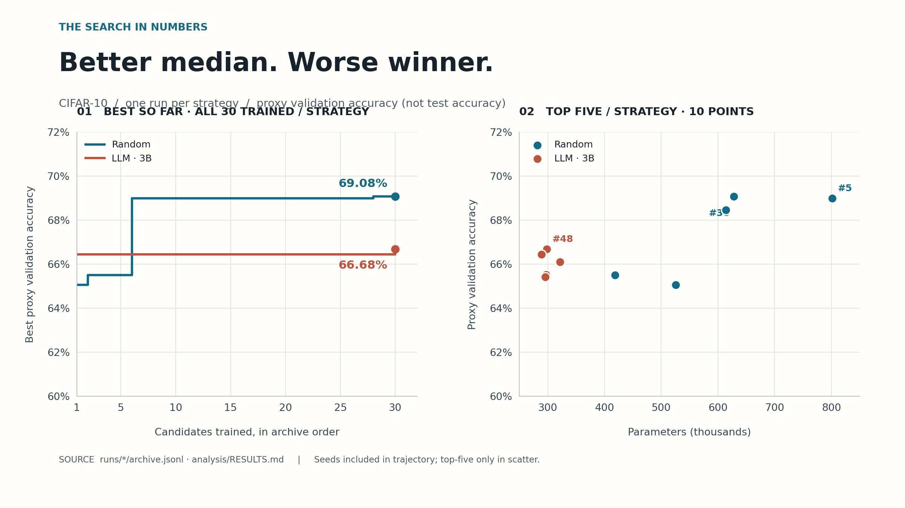

# LLM-guided neural architecture search on CIFAR-10

Compare **LLM-guided neural architecture search (NAS)** with a **random-search baseline** on CIFAR-10. A local Ollama `qwen2.5-coder:3b` model proposes PyTorch networks. The search checks each proposal, trains valid candidates with a fixed recipe, and returns validation scores to the LLM. In the recorded single run, random search found the better finalist: **92.72% test accuracy**, versus **89.34%** for the best LLM finalist after 20 epochs. This is a research experiment, not a browser-based training app.

[Explore the published results (static website)](https://avinashistoocool.github.io/llm-nas/) · [Read the recorded results](analysis/RESULTS.md) · [View the high-resolution comparison](analysis/figures/llm-nas-results.png)

The website shows recorded candidates and search trajectories. It does not run training in the browser.

## How it works

```text
Fixed CIFAR-10 train/validation split (45k / 5k)
                 │
                 ▼
Archive + validation scores ──► tournament selection ──► Ollama: mutate / crossover
          ▲                                                    │
          │                                                    ▼
Proxy training on GPU ◄── CPU dry run + AST checks ◄── candidate PyTorch code
          │
          └──► select top candidates ──► 20-epoch retraining ──► held-out test

Random baseline: sample candidates from a hand-designed architecture space.
Both strategies use the same checks, budgets, data split, and training recipe.
```

The search uses 5 proxy epochs on 10,000 training images and scores candidates on the 5,000-image validation split. It limits each model to 1 million parameters and 600 MFLOPs. The final stage retrains selected candidates on all 45,000 training images and measures accuracy on the held-out test set. See [`configs/cifar10.yaml`](configs/cifar10.yaml) for the exact settings. The LLM runs on the CPU (`num_gpu: 0`); the GPU trains the candidates. The pipeline can request the next proposal while the current candidate trains.

## Recorded results

One recorded comparison used 30 trained candidates per strategy. **Proxy validation accuracy is not test accuracy.** The proxy results guide search; the final results below come from separate 20-epoch training.

| Strategy | Proposals (excluding seeds) | Trained | Valid proposal rate | Best proxy validation | Median proxy validation, generated valid candidates | Best finalist test accuracy |
|---|---:|---:|---:|---:|---:|---:|
| Ollama Qwen2.5-Coder 3B (`llm_qwen3b`) | 46 | 30 | 59% | 66.68% | 59.78% | 89.34% |
| Random search (`random`) | 33 | 30 | 85% | 69.08% | 56.92% | **92.72%** |

| Finalist | Parameters | Proxy validation | 20-epoch validation | 20-epoch held-out test |
|---|---:|---:|---:|---:|
| `random#5` | 801,326 | 69.00% | 93.40% | **92.72%** |
| `random#30` | 627,870 | 69.08% | 92.32% | 91.33% |
| `llm_qwen3b#48` | 298,026 | 66.68% | 89.66% | **89.34%** |
| `llm_qwen3b#0` (seed) | 288,746 | 66.44% | 89.50% | 88.64% |

The best proxy model did not have the best final test score in the random run. These figures describe **one run**, not a statistically established ranking. The short proxy favors fast-converging models. The random baseline samples a hand-designed space; the LLM edits raw code and can fail checks or repeat proposals. The recorded LLM proposals had a higher median proxy score, but the random run found a stronger final model. More seeds, budgets, and model sizes are needed to assess generality.



The [original search-progress plot](analysis/search_progress.png) shows the archived proxy evaluations.

## View existing results without training

Read [`analysis/RESULTS.md`](analysis/RESULTS.md), the [high-resolution comparison](analysis/figures/llm-nas-results.png), and the [search-progress plot](analysis/search_progress.png). The [static results website](https://avinashistoocool.github.io/llm-nas/) offers an interactive view; it does not run training in your browser.

If you **already have** local `runs\llm_qwen3b\archive.jsonl` and `runs\random\archive.jsonl`, you can regenerate the report and plot from those archives. `runs\final_results.json` supplies the finalist test table when present:

```powershell
.\.venv\Scripts\python.exe -m analysis.report --runs llm_qwen3b random
```

This writes `analysis\RESULTS.md` and `analysis\search_progress.png`. Run it from the repository root. The run archives and checkpoints are **not included** in a fresh clone, so this command cannot regenerate the published report from the clone alone.

## Run a new search (Windows PowerShell)

You need Python, Git, [Ollama](https://ollama.com/), the CIFAR-10 downloads below, and a CUDA-capable NVIDIA GPU with a CUDA-enabled PyTorch installation. The settings target a 6 GB laptop GPU; available memory and runtime can vary. Check your [PyTorch installation](https://pytorch.org/get-started/locally/) if the CUDA check returns `False`. Training is not supported on a CPU with the default `device: cuda` configuration.

```powershell
git clone https://github.com/Avinashistoocool/llm-nas.git
Set-Location .\llm-nas
python -m venv .venv
.\.venv\Scripts\python.exe -m pip install -r requirements.txt
.\.venv\Scripts\python.exe -c "import torch; print(torch.cuda.is_available())"

New-Item -ItemType Directory -Force data | Out-Null
curl.exe -fL -o data/train.parquet "https://huggingface.co/datasets/uoft-cs/cifar10/resolve/main/plain_text/train-00000-of-00001.parquet"
curl.exe -fL -o data/test.parquet "https://huggingface.co/datasets/uoft-cs/cifar10/resolve/main/plain_text/test-00000-of-00001.parquet"
```

Start the Ollama app, or run `ollama serve` in **another** PowerShell window and leave it running. Then pull the configured model and start separate searches from the repository root:

```powershell
ollama pull qwen2.5-coder:3b
.\.venv\Scripts\python.exe -m nas.search --run llm_qwen3b --strategy llm --set search.budget=40
.\.venv\Scripts\python.exe -m nas.search --run random --strategy random --set search.budget=40
.\.venv\Scripts\python.exe -m nas.final --runs llm_qwen3b random
.\.venv\Scripts\python.exe -m analysis.report --runs llm_qwen3b random
```

The first training run converts the downloaded Parquet files into a local tensor cache. The test set is evaluated in `nas.final`, not during search. The default budget is 60 trained candidates; `search.budget=40` is an example override, **not** the budget that produced the recorded 30-candidate results. The final step trains the top two candidates from each run by default. Searches resume when you reuse a `--run` name. Use new run names to keep published and new results distinct. Training can take a long time.

To test the CLI without Ollama, use `llm.backend=mock`. This still trains candidates on the GPU; it is **not** an offline report viewer:

```powershell
.\.venv\Scripts\python.exe -m nas.search --run _mock --set llm.backend=mock search.budget=5 proxy.epochs=1
.\.venv\Scripts\python.exe -m pytest -q tests
```

## Code and safety

`nas/search.py` manages the archive, tournament selection, and search loop. `nas/space.py` defines random sampling and seeds. `nas/llm.py` connects to Ollama. `nas/validator.py` checks the candidate's syntax and selected operations. `nas/worker.py` runs CPU checks or GPU training through `nas/sandbox.py`. `nas/final.py` trains finalists; `analysis/report.py` builds the report and plot.

Candidate code is executed in a subprocess with timeouts after AST checks and a CPU dry run. This is a guardrail, **not strong isolation or a security boundary**. Do not run untrusted model output or treat these checks as protection against malicious code.
