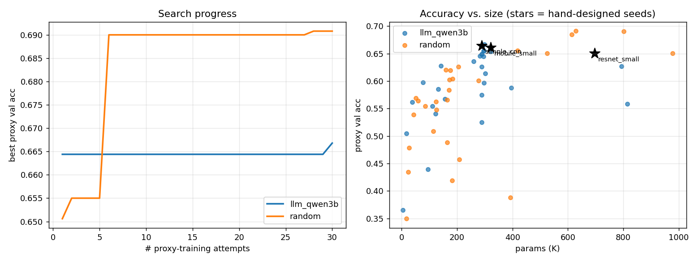

# Results

| run | proposals | proxy attempts | completed | completed proposals / proposals | best proxy val | median proxy val | best params |
|---|---:|---:|---:|---:|---:|---:|---:|
| llm_qwen3b | 46 | 30 | 30 | 59% | 0.6668 | 0.5978 | 298,026 |
| random | 33 | 30 | 28 | 85% | 0.6908 | 0.5675 | 627,870 |

## Failure modes

- **llm_qwen3b**: duplicate=9, error=8, invalid=2, ok=30
- **random**: invalid=3, ok=28, too_slow=2

## Finalist training (test evaluated after training for each finalist)

| run#id | origin | params | proxy val | full val | **test** | idea |
|---|---|---|---|---|---|---|
| random#5 | random | 801,326 | 0.6900 | 0.9340 | **0.9272** | random: inverted blocks, widths=[64, 96, 144], depths=[3, 3, 3], k=3, act=SiLU, residual=T |
| random#30 | random | 627,870 | 0.6908 | 0.9232 | **0.9133** | random: inverted blocks, widths=[64, 96, 144], depths=[3, 3, 3], k=3, act=ReLU, residual=T |
| llm_qwen3b#48 | mutate | 298,026 | 0.6668 | 0.8966 | **0.8934** | Introduce depthwise separable convolutions (DSConv) in the first stage of the PARENT A arc |
| llm_qwen3b#0 | seed:simple_cnn | 288,746 | 0.6644 | 0.8950 | **0.8864** | Plain 3-stage VGG-style CNN with BatchNorm and max-pooling. |

## Top-5 of `llm_qwen3b`

1. `#48` 0.6668, 298,026 params (mutate): Introduce depthwise separable convolutions (DSConv) in the first stage of the PARENT A architecture to potentially reduce parameters and improve effic
2. `#0` 0.6644, 288,746 params (seed:simple_cnn): Plain 3-stage VGG-style CNN with BatchNorm and max-pooling.
3. `#2` 0.6610, 321,578 params (seed:mobile_small): MobileNetV2-style inverted residual blocks (expansion 4) with depthwise convolutions.
4. `#24` 0.6552, 297,256 params (mutate): Introduce a depthwise separable convolution (DSConv) in the first stage to potentially reduce parameters and improve efficiency without significantly 
5. `#4` 0.6542, 295,290 params (mutate): Introduce a depthwise separable convolution (depthwise conv) in the 3rd stage of the parent architecture to reduce parameters and improve efficiency w

## Top-5 of `random`

1. `#30` 0.6908, 627,870 params (random): random: inverted blocks, widths=[64, 96, 144], depths=[3, 3, 3], k=3, act=ReLU, residual=True, se=True
2. `#5` 0.6900, 801,326 params (random): random: inverted blocks, widths=[64, 96, 144], depths=[3, 3, 3], k=3, act=SiLU, residual=True, se=True
3. `#22` 0.6846, 614,106 params (random): random: inverted blocks, widths=[64, 96, 144], depths=[3, 1, 2], k=3, act=SiLU, residual=True, se=False
4. `#1` 0.6550, 418,586 params (random): random: inverted blocks, widths=[64, 128], depths=[3, 3], k=3, act=GELU, residual=True, se=False
5. `#0` 0.6506, 525,394 params (random): random: inverted blocks, widths=[48, 72, 112, 160], depths=[2, 3, 2, 2], k=3, act=SiLU, residual=True, se=False
